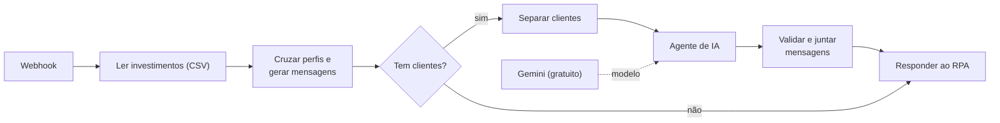
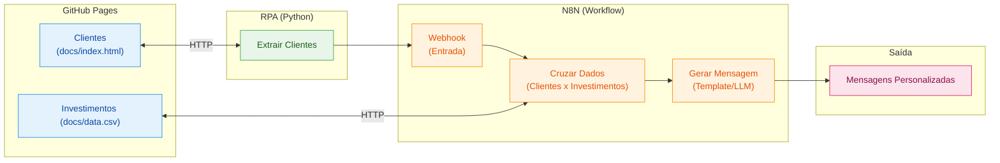

# Criando um Assistente de Investimentos com RPA e IA Generativa

## ✅ Solução implementada (MVP + Agente de IA)

O pipeline roda de ponta a ponta: o notebook extrai os 10 clientes da [página no GitHub Pages](https://aryribeiro.github.io/dio-lab-assistente-investimentos-rpa-n8n/), envia a lista ao Webhook do N8N, que cruza cada cliente com o [CSV de investimentos](https://aryribeiro.github.io/dio-lab-assistente-investimentos-rpa-n8n/data.csv) e pede a um **Agente de IA (Google Gemini, plano gratuito)** uma mensagem personalizada por cliente.




| Peça | Arquivo | O que faz |
|------|---------|-----------|
| Dados | [`docs/`](docs/) | Página de clientes e CSV de investimentos, publicados pelo GitHub Pages do fork |
| RPA | [`rpa/extrair_clientes.ipynb`](rpa/extrair_clientes.ipynb) | Lê a tabela `#clientes`, envia ao Webhook e mostra as mensagens. Sem Webhook configurado, roda em **modo simulado** com as mesmas regras do workflow (sem IA) |
| Workflow | [`n8n/workflow.json`](n8n/workflow.json) | Cruza perfil e saldo com o CSV, pede o texto ao Agente de IA, confere o texto e responde ao RPA |
| Evidências | [`evidencias/`](evidencias/) | Execução bem-sucedida e saída do workflow |

### Como executar

1. **Chave gratuita do Gemini:** crie em [Google AI Studio → Get API key](https://aistudio.google.com/apikey). **Não vincule conta de cobrança ao projeto**: com cobrança ativa, todo uso passa a ser pago, mesmo dentro dos limites gratuitos.
2. No N8N, importe `n8n/workflow.json` (**Workflows → Import from File**).
3. Abra o nó **Gemini (gratuito)**, crie a credencial *Google Gemini (PaLM) API* com a chave e selecione-a. A chave fica guardada no N8N; o `workflow.json` exportado leva só o nome da credencial.
4. Copie a URL do nó **Webhook**: a de teste (`/webhook-test/clientes`) vale depois de clicar em *Execute workflow*; a de produção (`/webhook/clientes`), com o workflow publicado/ativo.
5. Abra o notebook no Colab: [](https://colab.research.google.com/github/aryribeiro/dio-lab-assistente-investimentos-rpa-n8n/blob/main/rpa/extrair_clientes.ipynb)
6. Cole a URL em `N8N_WEBHOOK` (célula de configuração) e execute tudo. Com `N8N_WEBHOOK` vazio, o notebook gera as mensagens fixas localmente (modo simulado).

> O agente atende **um cliente por vez, com 7 s de intervalo**, para caber no limite gratuito de requisições por minuto. Com 10 clientes, a resposta leva cerca de 2 minutos; o notebook espera até 10.

Para testar o N8N localmente com Docker:

```bash
docker run -it --rm -p 5678:5678 docker.n8n.io/n8nio/n8n
```

### Contrato entre o RPA e o N8N

Entrada (`POST` no Webhook):

```json
{ "clientes": [ { "nome": "Ana Silva", "email": "ana@email.com", "saldo": "R$ 12.500,00", "perfil": "Conservador" } ] }
```

Saída (resposta do Webhook):

```json
{
  "total": 1,
  "geradas_por_ia": 1,
  "aviso": "Dados fictícios, para fins educacionais. Não é recomendação de investimento.",
  "mensagens": [
    {
      "nome": "Ana Silva", "email": "ana@email.com", "perfil": "Conservador", "saldo": 12500,
      "status": "ok",
      "recomendados": ["Poupança", "CDB Liquidez Diária", "Tesouro Selic"],
      "fora_do_alcance": [],
      "origem": "ia",
      "mensagem": "(texto escrito pelo Agente de IA a partir dos fatos da mensagem fixa)",
      "mensagem_fixa": "Olá, Ana! Como seu perfil é Conservador, priorizamos renda fixa, com foco em segurança e liquidez. Com o seu saldo de R$ 12.500,00, você já pode aplicar em: Poupança (6,2%, a partir de R$ 100,00), CDB Liquidez Diária (12,5%, a partir de R$ 1.000,00) e Tesouro Selic (13,0%, a partir de R$ 500,00). Conte com a gente para montar sua carteira!"
    }
  ]
}
```

- `status`: `ok`, `sem_produto_no_saldo`, `perfil_invalido` ou `saldo_invalido`.
- `origem`: `ia` (texto do agente aprovado na conferência) ou `modelo_fixo` (a mensagem fixa, com o `motivo`: falha na chamada, texto vazio, produto fora da lista, número que não está nos fatos, promessa de retorno ou cadastro incompleto).
- Envios com mais de **50 clientes** são recusados antes da IA: a resposta traz `total: 0` e o campo `erro` explicando o limite.

### Decisões técnicas

- **O saldo mínimo entra no cruzamento.** Recomendar só pelo perfil indicaria produtos que o cliente não pode comprar: Daniel (R$ 850) e Isabela (R$ 500) não alcançam o CDB Liquidez Diária (mínimo de R$ 1.000), e Bruno (R$ 3.200) não alcança o Fundo Multimercado (R$ 5.000). Esses produtos aparecem na mensagem como "faltam R$ X".
- **O saldo vem como texto** (`"R$ 12.500,00"`) e é convertido para número antes da comparação; o perfil é comparado sem diferenciar maiúsculas, acentos e espaços.
- **A rentabilidade é exibida, nunca calculada:** o CSV mistura formatos (`6.2%`, `IPCA+6.0%`, `Variável`).
- **Dado ruim não vira recomendação.** Perfil desconhecido ou saldo ilegível geram um pedido de atualização do cadastro.
- **Resposta síncrona** (nó *Respond to Webhook*): o próprio notebook mostra as mensagens, sem depender de outro canal.
- **Extração robusta:** `timeout`, `raise_for_status()`, leitura das células pela classe (`td.nome`, `td.email`...) com a posição como reserva e erro claro se a tabela sumir.
- **Modo simulado com as mesmas regras:** a lógica do nó Code foi portada para Python e as duas versões foram comparadas, campo a campo, com casos-limite (perfil inválido, saldo ilegível, saldo abaixo de todos os mínimos). As saídas são idênticas.
- **A IA escreve, mas não decide.** O cruzamento continua em código; o agente recebe como FATOS a mensagem fixa (produtos que cabem no saldo, mínimos, rentabilidades e quanto falta) e só reescreve o texto, com instrução de não citar outro produto, taxa ou número nem prometer retorno.
- **Texto da IA passa por conferência antes de sair.** O nó *Validar e juntar mensagens* rejeita resposta vazia ou longa demais, citação de produto que não é do cliente, valor em R$ ou percentual que não está nos fatos e promessas ("garantido", "sem risco"). Rejeitado, o cliente recebe a mensagem fixa e o `motivo` fica registrado.
- **A IA nunca derruba o fluxo.** O agente tenta até 3 vezes e, se falhar, segue adiante (*On Error: continue*); cadastro incompleto não usa IA. Sem chave ou sem cota, todos recebem a mensagem fixa.
- **Plano gratuito do Gemini:** um cliente por chamada, com 7 s entre chamadas (*Batch Processing* do agente).
- **Limite de 50 clientes por envio.** O Webhook não pede autenticação; o limite impede que um envio grande, por engano ou de terceiros, esgote a cota gratuita do Gemini. Listas maiores devem ser enviadas em lotes.
- **Fonte dos dados:** a página e o CSV vêm do GitHub Pages do próprio fork (pasta `docs/`): qualquer mudança em `docs/` vai ao ar com o push.

### Como foi validado

- Workflow importado e publicado num N8N 2.44.6 (Docker) com o modelo `gemini-3.5-flash-lite` (plano gratuito). Notebook executado do início ao fim contra ele: **10 clientes extraídos do GitHub Pages, 10 mensagens escritas pela IA e aprovadas na conferência**, em cerca de 1 min 20 s (saídas gravadas no próprio notebook).
- Casos-limite no N8N: 9 clientes de teste (perfil inválido, saldo ilegível, saldo abaixo de todos os mínimos, saldo milionário) devolveram HTTP 200; os cadastros inválidos ficaram com a mensagem fixa sem chamar a IA. Payload vazio ou malformado devolve `total: 0`, sem erro.
- Sem IA disponível (chave inválida), todos os clientes recebem a mensagem fixa com `motivo: falha na chamada à IA`, e essa mensagem é idêntica à do modo simulado do notebook.
- A conferência foi testada com respostas simuladas da IA: produto de outro perfil, promessa de retorno, número inventado, resposta vazia e erro caem na mensagem fixa; textos corretos passam.
- O modelo foi escolhido testando a chave: `gemini-2.5-flash` e `gemini-2.5-flash-lite` já não estão disponíveis para chaves novas.


---

## Descrição

Aprenda na prática como criar um fluxo de automação inteligente combinando técnicas de RPA (Robotic Process Automation) com workflows de IA no N8N.

Neste desafio, você vai construir um assistente de investimentos automatizado. O fluxo começa com a extração de dados de clientes em uma página web usando Python, passa pela orquestração de um workflow no N8N e termina com a geração de mensagens personalizadas para cada perfil de investidor.

O projeto foi pensado para ser simples e acessível, mesmo para quem está dando os primeiros passos em Python e automação. A ideia é que você entenda o conceito de RPA de forma leve e aplique tudo em um cenário realista do mercado financeiro.

## Objetivo do Projeto

Desenvolver um pipeline de automação que:

1. **Coleta dados de clientes** de uma página web simulada usando Python
2. **Processa as informações** através de um workflow no N8N
3. **Cruza perfis de investidor** com uma base de opções de investimento
4. **Gera mensagens personalizadas** para cada cliente

Ao final, você terá um sistema funcional que demonstra como empresas do setor financeiro podem automatizar a comunicação com clientes de forma inteligente.

## Arquitetura do Projeto



## Tecnologias e Ferramentas

O projeto utiliza ferramentas gratuitas e acessíveis, organizadas conforme cada etapa do fluxo:

| Etapa | Ferramenta | Função |
|-------|-----------|--------|
| Hospedagem | GitHub Pages | Servir a página de clientes e o CSV de investimentos |
| Extração (RPA) | Python + BeautifulSoup | Coletar dados dos clientes via web scraping |
| Orquestração | N8N | Processar dados, cruzar perfis e gerar mensagens |
| Geração com IA | Agente de IA no N8N | Criar mensagens personalizadas com LLM (desafio extra) |

Além dessas, você pode usar IAs generativas como **Gemini**, **Claude** ou **ChatGPT** como copilotos para auxiliar na escrita de código e tirar dúvidas ao longo do desenvolvimento.

## Roteiro do Desafio

### Etapa 1: Entenda o Projeto

Antes de começar, explore o repositório base que já contém a estrutura inicial:

1. **Página de Clientes (`docs/index.html`):** Uma página HTML hospedada no GitHub Pages com uma lista de clientes fictícios contendo nome, email, saldo e perfil de investidor (Conservador, Moderado ou Arrojado). Disponível online [neste link](https://digitalinnovationone.github.io/dio-lab-assistente-investimentos-rpa-n8n).
2. **Dados de Investimentos (`docs/data.csv`):** Um arquivo CSV também hospedado no GitHub Pages com opções de investimento organizadas por perfil. Disponível online [neste link](https://digitalinnovationone.github.io/dio-lab-assistente-investimentos-rpa-n8n/data.csv).
3. **Script de RPA (`rpa/extrair_clientes.ipynb`):** Um notebook Python que acessa a página de clientes e extrai os dados da tabela usando BeautifulSoup.

> 🤖 **Por que o script é considerado RPA?** Ele faz exatamente o que um humano faria manualmente: abre uma página, lê os dados de uma tabela e os envia para outro sistema. A diferença é que o "robô" (código) executa isso automaticamente. Essa abordagem é útil quando não existe uma API disponível ou quando precisamos integrar sistemas legados.

### Etapa 2: Configure o Ambiente

1. Faça um **fork** do repositório base para sua conta do GitHub
2. Crie uma conta no [N8N Cloud](https://n8n.io/) ou instale localmente
3. Abra o notebook `rpa/extrair_clientes.ipynb` no [Google Colab](https://colab.research.google.com/) e execute para entender o fluxo de extração

> 💡 **Atenção:** O envio ao N8N já está implementado: basta colar a URL do Webhook em `N8N_WEBHOOK` depois de criá-lo na próxima etapa. Com a variável vazia, o notebook roda em modo simulado.

### Etapa 3: Desenvolva o Workflow no N8N

Este é o coração do desafio! Monte um fluxo que:

1. Receba os dados dos clientes via Webhook (copie a URL gerada e configure no script Python)
2. Leia o arquivo `docs/data.csv` com as opções de investimento
3. Cruze o perfil de cada cliente com a opção adequada
4. Gere uma mensagem de recomendação para cada cliente

### Etapa 4 (MVP): Mensagens Estáticas

Para a versão mínima, use templates de mensagem fixos baseados no perfil:

- **Conservador:** Foco em renda fixa e segurança
- **Moderado:** Mix equilibrado entre renda fixa e variável
- **Arrojado:** Ênfase em ações e maior potencial de retorno

### Etapa 5 (Desafio): Integração com IA Generativa

Conecte o Agente de IA do N8N a um modelo como Gemini ou GPT para:

- Analisar o contexto do cliente (saldo, perfil)
- Gerar mensagens únicas e personalizadas
- Criar recomendações mais inteligentes e humanizadas

## Entregáveis

### MVP (Mínimo Viável)

- [x] Repositório forkado com o workflow N8N implementado
- [x] Workflow N8N exportado (`n8n/workflow.json`) com mensagens estáticas
- [x] Script de RPA integrado ao Webhook do N8N
- [x] Print ou vídeo demonstrando o fluxo funcionando de ponta a ponta

### Desafio Completo

- [x] Todos os itens do MVP
- [x] Integração com Agente de IA no N8N
- [x] Mensagens geradas dinamicamente via LLM
- [x] Documentação explicando as decisões técnicas

## Estrutura do Repositório

```
📁 dio-lab-assistente-investimentos-rpa-n8n/
├── 📄 README.md
├── 📁 rpa/
│   └── 📄 extrair_clientes.ipynb   # ✅ Extração + envio ao Webhook (ou modo simulado)
├── 📁 n8n/
│   └── 📄 workflow.json            # ✅ Workflow exportado (Webhook → CSV → cruzamento → resposta)
├── 📁 evidencias/
│   ├── 🖼️ n8n-execucao.png         # ✅ Execução com o Agente de IA (10 clientes)
│   └── 🖼️ n8n-saida-mensagens.png  # ✅ Saída conferida: 10 de 10 escritas pela IA
└── 📁 docs/
    ├── 📄 index.html               # ✅ Página de clientes (já implementado)
    └── 📄 data.csv                 # ✅ Opções de investimento (já implementado)
```

## Prompts Úteis para Copilotos de IA

| Tarefa | Sugestão de Prompt |
|--------|-------------------|
| Gerar dados fictícios | "Crie 10 clientes fictícios com nome, email, saldo e perfil de investidor em JSON" |
| Entender código | "Explique o que faz a biblioteca BeautifulSoup em Python" |
| Debugar erros | "Meu script Python está dando erro X, o que pode ser?" |
| Montar workflow | "Como configuro um webhook no N8N para receber dados JSON?" |

## Referências

- [Documentação do N8N](https://docs.n8n.io/)
- [BeautifulSoup: Web Scraping com Python](https://realpython.com/beautiful-soup-web-scraper-python/)
- [GitHub Pages: Guia Rápido](https://pages.github.com/)

---
